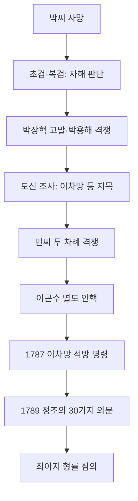
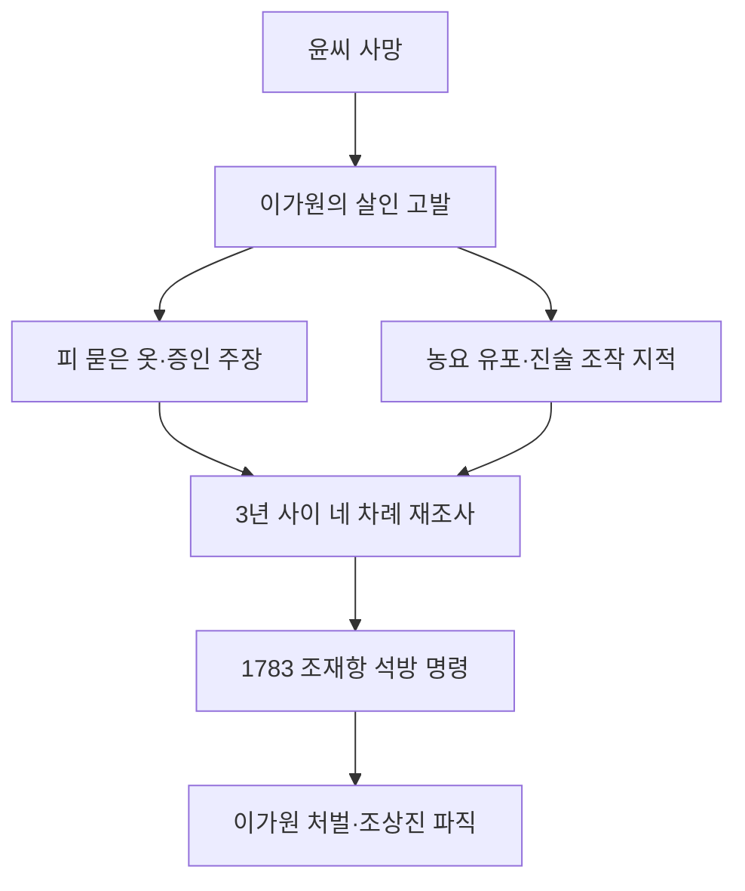
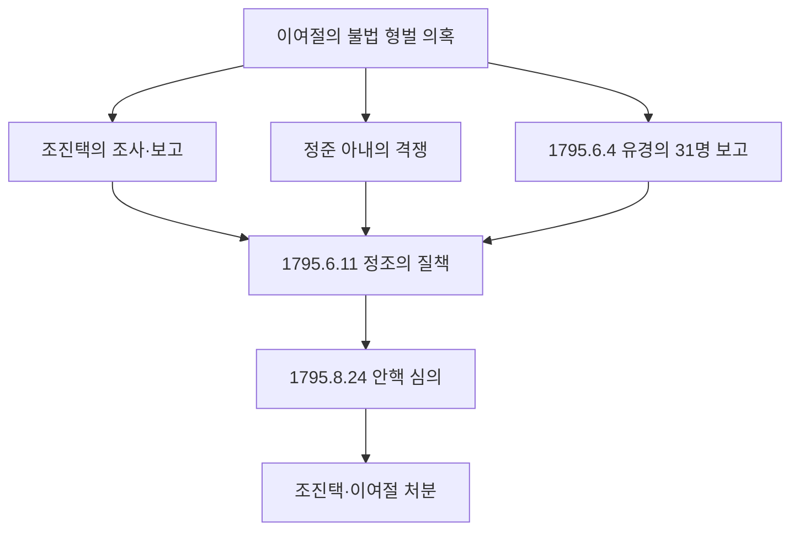
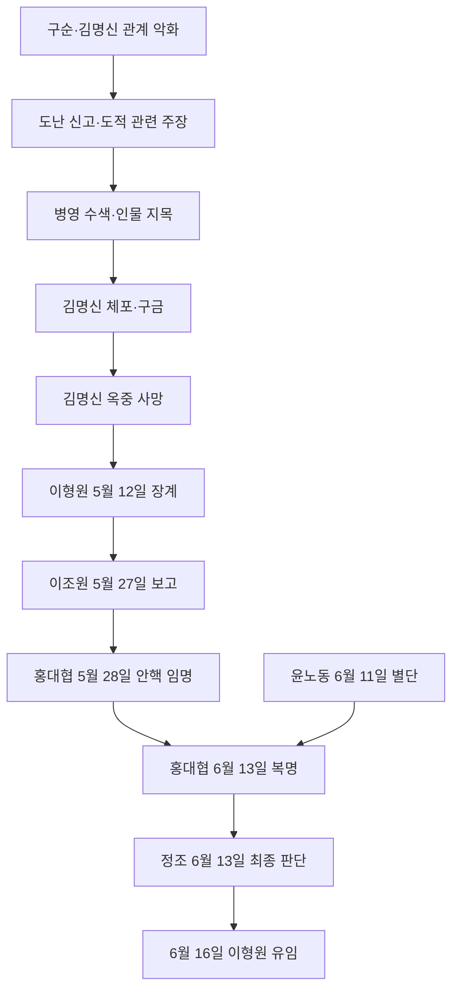
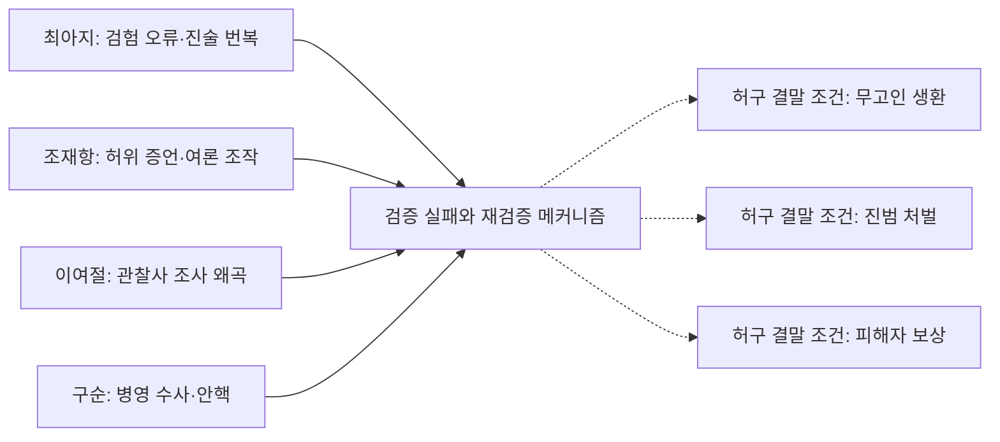

# 네 사건 공식 사료 기반 시간·절차 DAG

이 그래프의 화살표는 **기록된 절차의 선후 또는 공식 보고 흐름**을 뜻한다. 실제 범죄 인과·가해자 확정·공모는 아니다. 노드는 일부 조서를 요약한 것으로 원문 전체 전사가 아니다. 정조의 상충하는 판단과 처분의 미집행 여부를 유지한다.

## 최아지·이차망 — 1785–1789 · 황해도 평산

| 노드 | 기록 내용 | 출처 |
|---|---|---|
| c1 박씨 사망 | 사망 방식 미확정 | [CH-002](https://db.history.go.kr/joseon/item/level.do?levelId=jlawb_200r_0020_0020_0050_0090_0080) |
| c2 초검·복검: 자해 판단 | 自刺; 검험 결과 | [CH-002](https://db.history.go.kr/joseon/item/level.do?levelId=jlawb_200r_0020_0020_0050_0090_0080) |
| c3 박장혁 고발·박용해 격쟁 | 유족의 타살 주장과 재조사 청구 | [CH-002](https://db.history.go.kr/joseon/item/level.do?levelId=jlawb_200r_0020_0020_0050_0090_0080) |
| c4 도신 조사: 이차망 등 지목 | 최아지·이차망 공모 혐의; 구금 | [CH-002](https://db.history.go.kr/joseon/item/level.do?levelId=jlawb_200r_0020_0020_0050_0090_0080) |
| c5 민씨 두 차례 격쟁 | 1786년 남편 구명 | [CH-001](https://db.history.go.kr/joseon/item/level.do?levelId=jlawb_420_0080_0040_0030) |
| c6 이곤수 별도 안핵 | 사단의 진술 번복·조광진 자백 | [CH-002](https://db.history.go.kr/joseon/item/level.do?levelId=jlawb_200r_0020_0020_0050_0090_0080) |
| c7 1787 이차망 석방 명령 | 홍병찬·엄사만 문책 명령 | [CH-003](https://sillok.history.go.kr/id/kva_11104016_003) |
| c8 1789 정조의 30가지 의문 | 앞선 안핵·자백·증언까지 재검토 | [CH-002](https://db.history.go.kr/joseon/item/level.do?levelId=jlawb_200r_0020_0020_0050_0090_0080) |
| c9 최아지 형률 심의 | 장100·유2000리 준용 논의; 집행 불명 | [CH-002](https://db.history.go.kr/joseon/item/level.do?levelId=jlawb_200r_0020_0020_0050_0090_0080) |

## 조재항 — 1781–1783 · 황해도 배천

| 노드 | 기록 내용 | 출처 |
|---|---|---|
| j1 윤씨 사망 | 사망 원인 쟁점 | [JH-002](https://db.history.go.kr/joseon/item/level.do?levelId=jlawb_200_0020_0020_0050_0080_0080) |
| j2 이가원의 살인 고발 | 조재항을 범인으로 지목 | [JH-003](https://sillok.history.go.kr/id/kva_10706003_004) |
| j3 피 묻은 옷·증인 주장 | 물증과 증언의 진실성 논쟁 | [JH-002](https://db.history.go.kr/joseon/item/level.do?levelId=jlawb_200_0020_0020_0050_0080_0080) |
| j4 농요 유포·진술 조작 지적 | 정조의 최종 비판에서 등장 | [JH-003](https://sillok.history.go.kr/id/kva_10706003_004) |
| j5 3년 사이 네 차례 재조사 | 조상진의 피상적 재조사 비판 | [JH-003](https://sillok.history.go.kr/id/kva_10706003_004) |
| j6 1783 조재항 석방 명령 | 살인 누명 해소에 대한 당시 왕의 판단 | [JH-003](https://sillok.history.go.kr/id/kva_10706003_004) |
| j7 이가원 처벌·조상진 파직 | 허위 고발 및 부실 조사 문책 | [JH-003](https://sillok.history.go.kr/id/kva_10706003_004) |

## 이여절·조진택 — 1794–1795 · 경상도 창원

| 노드 | 기록 내용 | 출처 |
|---|---|---|
| y1 이여절의 불법 형벌 의혹 | 다수 사망 경위 조사 | [YE-003](https://sillok.history.go.kr/id/kva_11809008_002) |
| y2 조진택의 조사·보고 | 전염병 등 면책 취지 보고 | [YE-003](https://sillok.history.go.kr/id/kva_11809008_002) |
| y3 정준 아내의 격쟁 | 정준 등의 억울함 호소 | [YE-005](https://sillok.history.go.kr/id/kva_11906011_001) |
| y4 1795.6.4 유경의 31명 보고 | 암행 활동 결과; 숫자는 보고치 | [YE-004](https://sillok.history.go.kr/id/kva_11906004_006) |
| y5 1795.6.11 정조의 질책 | 조진택 조사 부정·유경 안핵 임명 | [YE-005](https://sillok.history.go.kr/id/kva_11906011_001) |
| y6 1795.8.24 안핵 심의 | 25명 장살 의견; 31명과 별도 집계 | [YE-006](https://sillok.history.go.kr/id/kva_11908024_003) |
| y7 조진택·이여절 처분 | 삭직·유배 명령; 집행 별도 확인 | [YE-007](https://sillok.history.go.kr/id/kva_11909021_001) |

## 구순·김명신 — 1793 · 충청도 청주·공주

| 노드 | 기록 내용 | 출처 |
|---|---|---|
| g1 구순·김명신 관계 악화 | 선행 왕래·히책 편지 등 공초 | [GS-006](https://sillok.history.go.kr/id/kva_11706013_003) |
| g2 도난 신고·도적 관련 주장 | 1793년 2월 소장·증언 | [GS-006](https://sillok.history.go.kr/id/kva_11706013_003) |
| g3 병영 수색·인물 지목 | 2월 말 병영 출동과 탐문 | [GS-006](https://sillok.history.go.kr/id/kva_11706013_003) |
| g4 김명신 체포·구금 | 3월 4일 체포 지시 진술 | [GS-006](https://sillok.history.go.kr/id/kva_11706013_003) |
| g5 김명신 옥중 사망 | 사망 원인·직접 인과 미확정 | [GS-006](https://sillok.history.go.kr/id/kva_11706013_003) |
| g6 이형원 5월 12일 장계 | 도난 부재·혹형 등 보고 | [GS-001](https://sillok.history.go.kr/id/kva_11705012_003) |
| g7 이조원 5월 27일 보고 | 정조가 현장 미조사 비판 | [GS-003](https://sillok.history.go.kr/id/kva_11705027_002) |
| g8 홍대협 5월 28일 안핵 임명 | 기존 지방 보고와 분리한 조사 | [GS-004](https://sjw.history.go.kr/search/inspectionDayList.do?wday=17930528L0) |
| g9 윤노동 6월 11일 별단 | 복명 전 처분 보류 | [GS-005](https://db.history.go.kr/common/compareViewer.do?levelId=bb_181r_001_06_0070&type=joseon) |
| g10 홍대협 6월 13일 복명 | 소규모 도난·사망 인과에 관한 평가 | [GS-006](https://sillok.history.go.kr/id/kva_11706013_003) |
| g11 정조 6월 13일 최종 판단 | 구순·이광섭 처분, 이형원 문책 | [GS-006](https://sillok.history.go.kr/id/kva_11706013_003) |
| g12 6월 16일 이형원 유임 | 초기 파직 명령과 후속 인사 구별 | [GS-008](https://sillok.history.go.kr/id/kva_11706016_002) |

## 네 사건 통합 비교 — 역사적 사례의 **메커니즘 분류**

실제 사건들을 하나의 인과 과정으로 연결하지 않는다. 공통 구조만 유형별로 비교한다. 각 사건의 기록을 창작물에 이식하는 단계는 별도 창작 작업이다.

